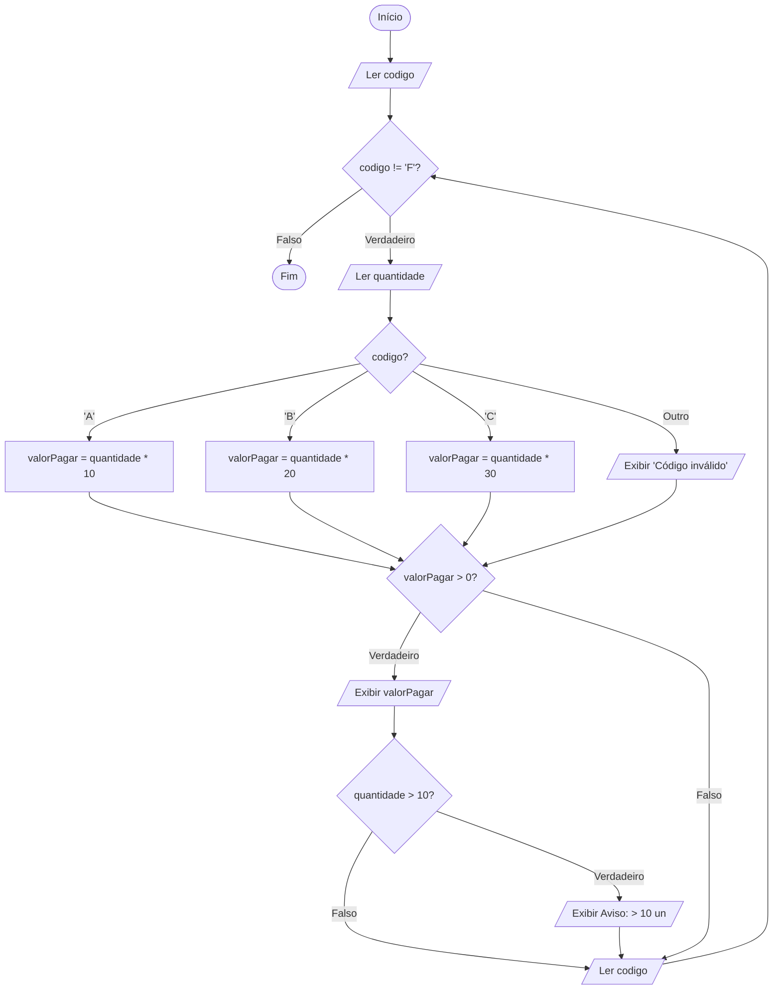

# Aula 02: Estruturas de Seleção, Desvios Condicionais e Repetição

## Seleção Simples e Dupla

Na aula anterior, estudamos algoritmos puramente sequenciais (onde toda instrução é executada sem exceção). Contudo, problemas do mundo real exigem que determinadas instruções sejam executadas **apenas se uma condição for verdadeira**, ou que caminhos alternativos sejam tomados.

### 1. Seleção Simples (`se-então`)

Executa uma instrução (ou bloco) somente se a expressão lógica for avaliada como **verdadeira**; caso seja falsa, nada é feito.

* Sintaxe em Pseudolinguagem:

```pascal
se <expressão lógica>
então <comando>

```

### 2. O Papel do Comando Composto (`início ... fim`)

Quando mais de uma ação precisa ser executada dentro do `então` ou do `senão`, agrupam-se as instruções delimitando-as com `início` e `fim`, formando sintaticamente um único comando composto.

```pascal
se (nota1 >= 6) e (nota2 >= 6) e (nota3 >= 6)
então início
    média <- (nota1 + nota2 + nota3) / 3
    escrever (média)
fim

```

### 3. Seleção Dupla (`se-então-senão`)

Garante a execução de **um de dois caminhos mutuamente exclusivos** a partir de um único teste booleano.

```pascal
se média >= 6.0
então escrever ('Aprovado')
senão escrever ('Reprovado')

```

* **Simbologia ANSI em Fluxograma:** O bloco de decisão é representado por um **losango**, que possui obrigatoriamente uma linha de entrada e **duas linhas de saída identificadas** (`verdadeiro` e `falso`).

---

## Seleção Aninhada e Seleção Múltipla

### 1. Comandos Aninhados (Encadeados)

Permitem avaliar regras hierárquicas sucessivas. Uma vez encontrada uma condição verdadeira, os ramos subsequentes contidos na cláusula `senão` não são avaliados, economizando processamento computacional em relação a múltiplos `se` independentes.

```pascal
se média >= 9.0
então conceito <- 'A'
senão se média >= 7.5
    então conceito <- 'B'
    senão se média >= 6.0
        então conceito <- 'C'
        senão conceito <- 'D'
```

### 2. Comando de Seleção Múltipla (`caso ... seja`)

Substitui cadeias longas de `se-senão-se` quando a decisão se baseia no valor ordinal exato (como `inteiro` ou `caractere`) de uma única expressão.

* Sintaxe:

```pascal
caso <expressão> seja
    <rótulo 1>: <comando 1>
    <rótulo 2>: <comando 2>
    [senão <comandos>]
fim caso

```

---

## Transações com Desconto e Validação

### Estudo de Caso: Classificação de Transações e Processamento em Lote

Em pipelines de ingestão para Big Data e e-commerce, precisamos validar a integridade dos dados de entrada, calcular regras de faturamento com base no tipo de registro e repetir o processo até o término do lote de dados.

* **Regras de Negócio:**
1. A transação recebe um código de livro: `'A'` (R$ 10,00), `'B'` (R$ 20,00) ou `'C'` (R$ 30,00).

2. Recebe a quantidade vendida de livros.

3. Se a quantidade for superior a 10 unidades, emite aviso de venda em escala.

4. O algoritmo processa transações continuamente até que seja digitado um código de parada `'F'` (sentinela / marca de parada após os dados).

### Implementação do Algoritmo em Pseudocódigo Estruturado

```pascal
Algoritmo FaturamentoTransacoes
{PROCESSA VENDAS DE LIVROS ATE O CODIGO DE TERMINO 'F'}

Entradas: codigo (caractere), quantidade (inteiro)
Saídas: valorPagar (real)

início
    ler (codigo)
    enquanto codigo <> 'F' faça
    início
        ler (quantidade)
        caso codigo seja
            'A': valorPagar <- quantidade * 10
            'B': valorPagar <- quantidade * 20
            'C': valorPagar <- quantidade * 30
            senão início
                valorPagar <- 0
                escrever ('Código de item inválido!')
            fim
        fim caso
        
        se valorPagar > 0
        então início
            escrever (valorPagar)
            se quantidade > 10
            então escrever ('Aviso: Lote com mais de 10 unidades vendidas.')
        fim
        
        ler (codigo) {Leitura do próximo registro ou sentinela de parada}
    fim
fim

```

#### Fluxo Lógico em Diagrama (Mermaid / Padrão draw.io)



## Validação com Teste de Mesa e Encerramento

Para validar algoritmos com bifurcações condicionais, o **teste de mesa** deve necessariamente abranger casos que ativem os ramos `verdadeiro` e `falso`, bem como rótulos inválidos.

#### Rastreamento da Simulação (Simulação de 3 Registros)

| Passo | Linha Executada | `codigo` | `quantidade` | `valorPagar` | Condição Avaliada | Saída Gerada em Tela |
| --- | --- | --- | --- | --- | --- | --- |
| **1** | `início` | - | - | - | - | - |
| **2** | `ler (codigo)` | `'B'` | - | - | - | - |
| **3** | `enquanto ...` | `'B'` | - | - | `'B' <> 'F'` (V) | - |
| **4** | `ler (quantidade)` | `'B'` | 12 | - | - | - |
| **5** | `caso codigo seja` | `'B'` | 12 | **240.0** | Rótulo `'B'` acionado | - |
| **6** | `se valorPagar > 0` | `'B'` | 12 | 240.0 | `240.0 > 0` (V) | `240.0` |
| **7** | `se quantidade > 10` | `'B'` | 12 | 240.0 | `12 > 10` (V) | `Aviso: Lote com mais de 10 unidades vendidas.` |
| **8** | `ler (codigo)` | `'Z'` | 12 | 240.0 | - | - |
| **9** | `enquanto ...` | `'Z'` | 12 | 240.0 | `'Z' <> 'F'` (V) | - |
| **10** | `ler (quantidade)` | `'Z'` | 5 | 240.0 | - | - |
| **11** | `caso codigo seja` | `'Z'` | 5 | **0.0** | Cláusula `senão` | `Código de item inválido!` |
| **12** | `se valorPagar > 0` | `'Z'` | 5 | 0.0 | `0.0 > 0` (F) | *(Ramo ignorado)* |
| **13** | `ler (codigo)` | `'F'` | 5 | 0.0 | - | - |
| **14** | `enquanto ...` | `'F'` | 5 | 0.0 | `'F' <> 'F'` (F) | Laço encerrado |
| **15** | `fim` | `'F'` | 5 | 0.0 | - | Execução concluída. |
